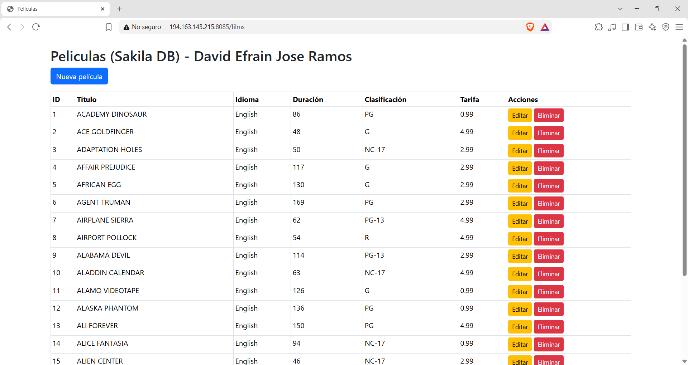
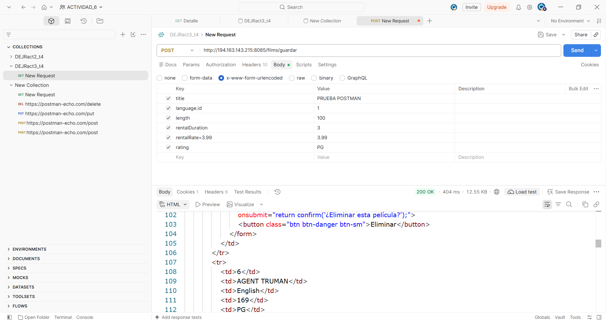
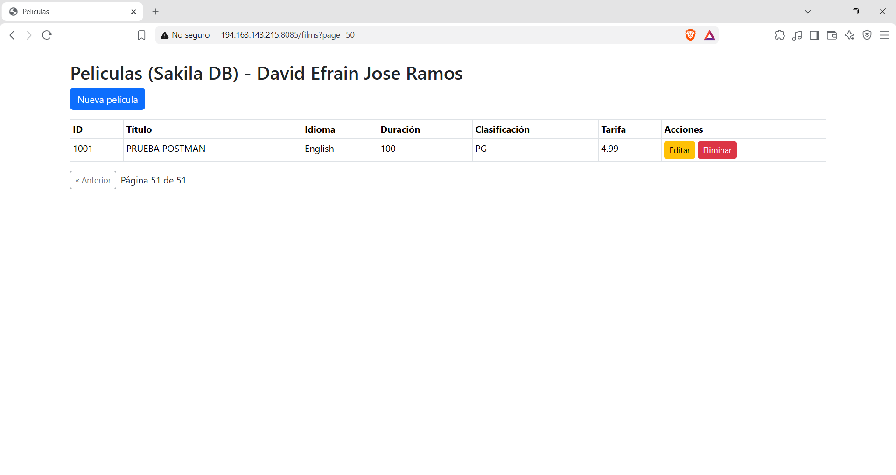
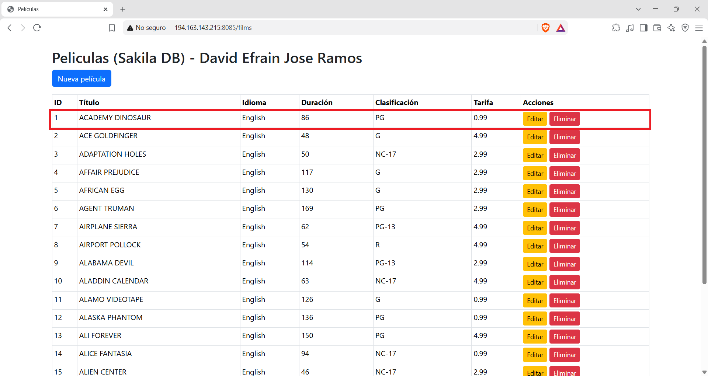
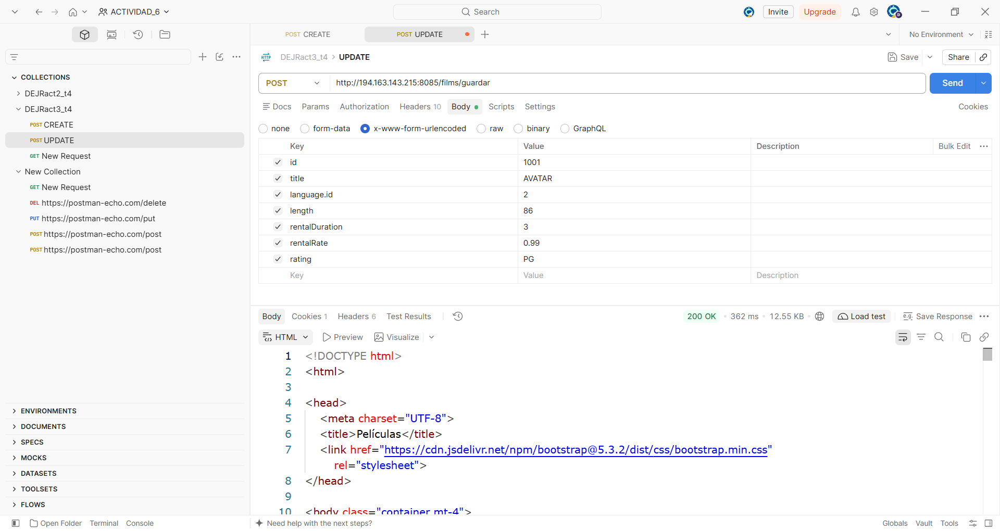
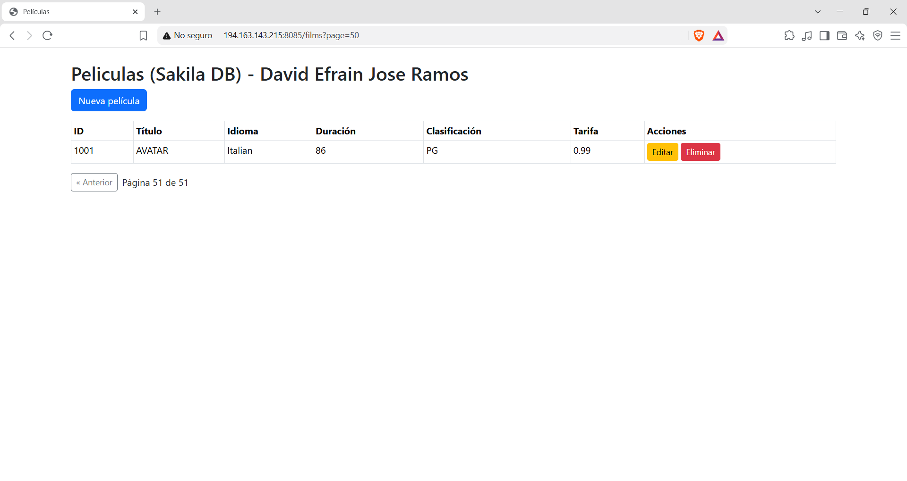
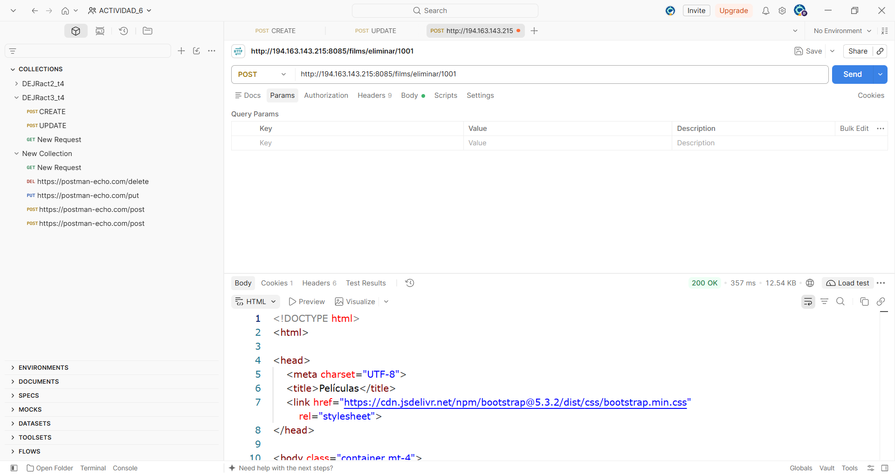
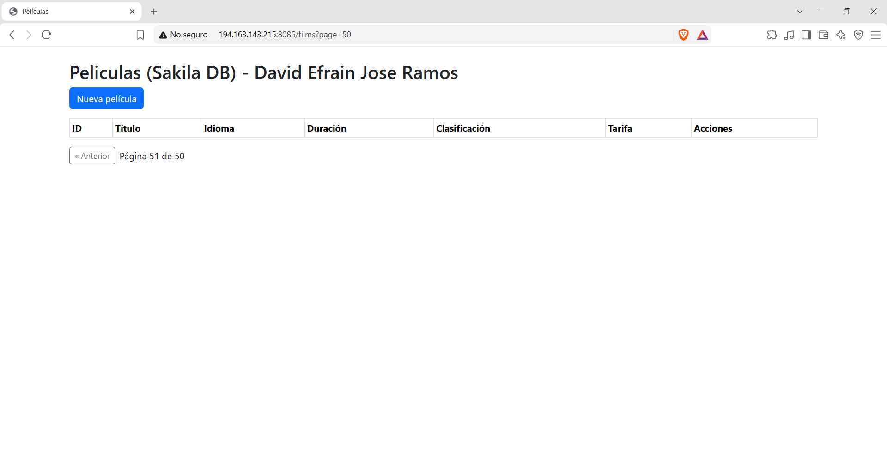
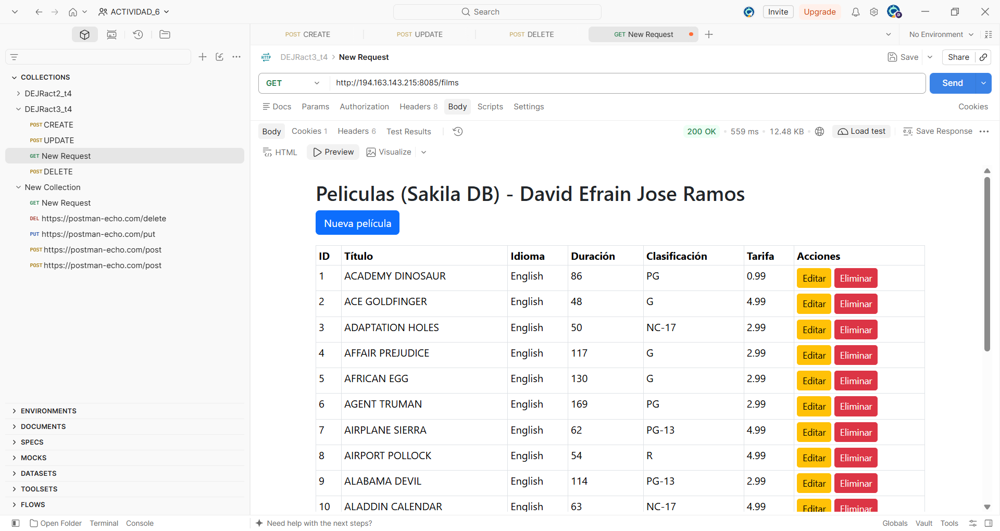

# 3. Act3. CRUD en Spring Boot y Relaciones.
## Construí un CRUD completo en Spring Boot conectado a una base de datos real, implemente al menos una relación entre entidades, y lo probé con sus propias vistas dentro del mismo proyecto y con Postman.
#### Elaborado por: David Efraín José Ramos NL 19
***
### Preguntas de la fase tres:
##### a) ¿Qué dos entidades elegiste y qué tipo de relación implementaste entre ellas (uno a muchos, muchos a uno)?
Como utilice la base de datos de Sakila utilice 'Film' y 'Language'. Utilice una relacion una a muchos, porque un lenguaje puede tener muchas peliculas pero una pelicula solo puede tener un lenguaje.

##### b) ¿Qué es un Repository en Spring Data JPA y qué ventaja tiene sobre escribir tú mismo las consultas SQL?

Un Repository en Spring Data JPA es una interfaz que le dice a Spring qué entidad manejar y cómo se llama su llave primaria.
Un repositorio es es donde definimos todo lo relacionado con la comunicación a la base de datos y también utiliza los modelos.
Un repositorio mediante JPA nos ayuda a comunicarnos con la base de datos.

Las ventajas de escribir tu mismo las consultas de SQL es que hay menos errores a diferencia de los que importamos una base de datos.

###### c) ¿Por qué es una buena práctica separar la lógica en una capa de Service en vez de ponerla directamente en el Controller?
Por la division de responsabilidades y preocupaciones en un proyecto. El modelo MVC los divide en tres funciones Controller: recibe la petición HTTP y decide qué vista o respuesta devolver; Service: contiene las reglas de negocio; Repository: accede a los datos.

##### d) Pega el enlace de tu repositorio de GitHub, y el link de tu proyecto ya corriendo en el VPS.

Link de repositorio: https://github.com/David-Ramos1010/DEJRact3_t4
Links del VPS: http://194.163.143.215:8085/films
Postman: https://lunar-zodiac-927693.postman.co/workspace/ACTIVIDAD_6~44ba4e90-6ad2-45f4-9b2a-2679cb0c5bce/collection/56488148-f0a8cbcf-3cdc-4ca0-8046-d7ccd11dd817?action=share&source=copy-link&creator=56488148

### Imagenes:

#### Dos entidades relacionadas

***
#### CREATE

#### READ

#### UPDATE

#### DELETE

#### Elaborado por: David Efraín José Ramos NL 19